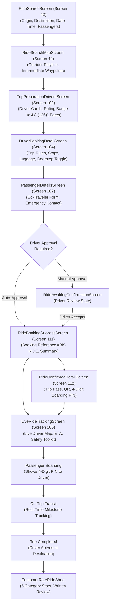
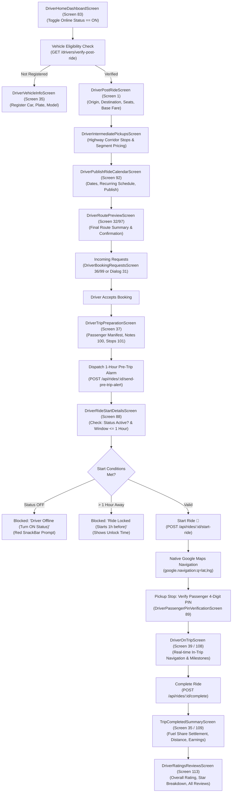
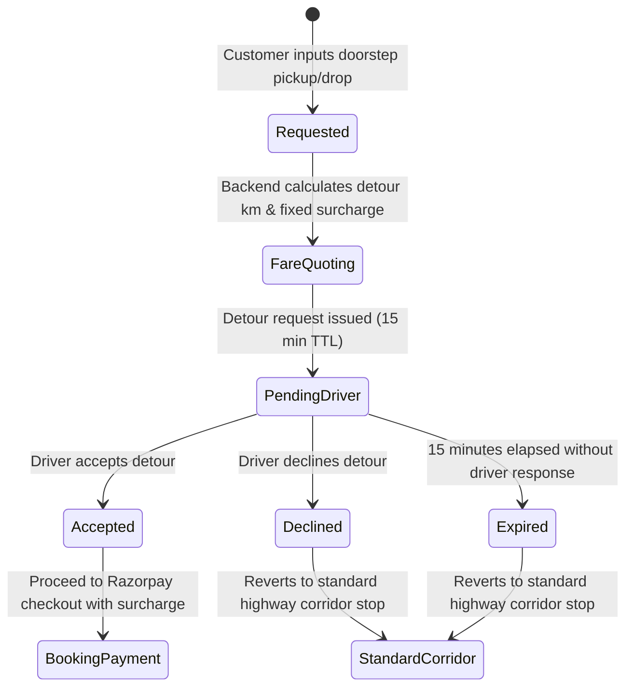

# Zaatra Ride Module: End-to-End Architectural, Screen & API Specification

> **Target Audience**: AI Models, Lead Architects, Full-Stack Engineers, Mobile Developers  
> **System**: Zaatra Ride-Sharing & Intercity Carpooling Ecosystem  
> **Platform**: Flutter 3.x (Android & iOS), Node.js / Express REST API Backend  
> **Document Status**: Production Verified Architectural Reference  
> **Verification**: 100% Audited Against Codebase (`lib/views/screens/`, `lib/services/`, `lib/models/`)

---

## Table of Contents
1. [Executive Summary & System Domain](#1-executive-summary--system-domain)
2. [End-to-End Lifecycles & State Machines](#2-end-to-end-lifecycles--state-machines)
3. [Customer-Side Ride Module (Screen-by-Screen Specification)](#3-customer-side-ride-module-screen-by-screen-specification)
4. [Driver-Side Ride Module (Screen-by-Screen Specification)](#4-driver-side-ride-module-screen-by-screen-specification)
5. [Complete REST API Specification & JSON Schemas](#5-complete-rest-api-specification--json-schemas)
6. [Critical Business Rules, Security & Edge Cases](#6-critical-business-rules-security--edge-cases)
7. [Cross-Module State Synchronization & Local Persistence](#7-cross-module-state-synchronization--local-persistence)

---

## 1. Executive Summary & System Domain

### 1.1 Overview
Zaatra is a peer-to-peer intercity and regional carpooling platform that connects drivers travelling between cities with passengers seeking affordable, comfortable shared rides. The platform optimizes route utilization through **corridor-based matching**, **intermediate highway stop pickups**, and **optional doorstep (door-to-door) pickup requests**.

### 1.2 Domain Glossary
- **Ride (Driver Published)**: A planned journey posted by an onboarded, KYC-verified driver containing an origin, destination, scheduled departure date/time, vehicle information, intermediate corridor waypoints, seat capacity, luggage limits, and per-seat pricing.
- **Corridor Stop**: Designated intermediate pickup/drop points along the driver's highway trajectory (e.g. bypasses, toll plazas, metro hubs) where passengers can board or alight with zero route detour.
- **Doorstep (Door-to-Door) Detour**: An optional pickup or drop point requested by a passenger off the main highway corridor. The system calculates the detour distance and adds a fixed, itemized detour surcharge. The driver then accepts or declines the detour request (no price bargaining or counter-offers).
- **Booking**: A passenger's reservation of one or more seats on a ride, associated with an origin, destination, Razorpay payment reference, and boarding verification PIN.
- **1-Hour Start Ride Lock**: A safety constraint where a driver can only initiate the official ride and launch turn-by-turn navigation within **1 hour prior to the scheduled departure time** (or during the active journey).
- **Dashboard Availability Status**: A driver toggle (`Active/On` vs `Offline/Off`). The driver **must be Active (ON)** to start rides, accept booking requests, or post rides.
- **Boarding PIN**: A 4-digit numeric verification code issued to the passenger upon booking confirmation. The driver must physically input this PIN in the driver app to verify boarding before departing a stop.
- **Pre-Trip Alarm**: An automated or manual 1-hour pre-departure notification dispatched to passengers and drivers alerting them to start preparing for travel.

### 1.3 Tech Stack Architecture
- **Mobile Client**: Flutter 3.x (Dart), `Material 3`, `SharedPreferences` for local offline sync, `url_launcher` for native Google Maps navigation intents.
- **Backend API**: REST API serving JSON over HTTPS with Bearer JWT Authentication (`Authorization: Bearer <token>`).
- **Payments**: Razorpay SDK (Order creation, signature verification, automatic refund processing on cancellation).
- **Mapping & Routing**: Google Directions & Places API with corridor geo-radius calculations.

---

## 2. End-to-End Lifecycles & State Machines

### 2.1 Customer Ride Lifecycle



---

### 2.2 Driver Ride Lifecycle



---

### 2.3 Doorstep (Door-to-Door) Detour Request & Approval Lifecycle

> **Note on Pricing**: Zaatra features **fixed, system-calculated pricing**. There is **no in-app bargaining, price negotiation, or counter-offering** between passengers and drivers. When a customer requests a doorstep pickup, the fare engine calculates a standardized detour surcharge based on additional distance and time. The driver only decides whether to **Accept** or **Decline** the detour.



---

## 3. Customer-Side Ride Module (Screen-by-Screen Specification)

### 3.1 `RideSearchScreen` (Screen 42)
- **File**: `lib/views/screens/customer/customer-ride/ride_search_screen_42.dart`
- **Purpose**: Primary customer entry screen for searching available carpools.
- **Key UI Elements**:
  - `Pickup` and `Destination` input fields with Google Places Autocomplete integration.
  - Date picker & Time picker.
  - Passenger count stepper (`1` to `6`).
  - "Search Rides" CTA button.
  - Popular intercity corridor suggestions chips (e.g. Hyderabad $\rightarrow$ Vijayawada, Hyderabad $\rightarrow$ Warangal).
- **Navigation**:
  - Navigates to `RideSearchMapScreen` (Screen 44) with search parameters.

### 3.2 `RideSearchMapScreen` (Screen 44)
- **File**: `lib/views/screens/customer/customer-ride/ride_search_map_screen_44.dart`
- **Purpose**: Displays the corridor route polyline on an interactive map with key intermediate highway stops.
- **Key UI Elements**:
  - Interactive Google Map with pickup pin, destination pin, and route polyline.
  - Intermediate stops summary pills along the highway.
  - Bottom summary card: Estimated travel duration, total distance, and available drivers count.
  - "View Drivers" CTA button.
- **Navigation**:
  - Navigates to `TripPreparationDriversScreen` (Screen 102).

### 3.3 `TripPreparationDriversScreen` (Screen 102)
- **File**: `lib/views/screens/customer/customer-ride/trip_preparation_drivers_screen_102.dart`
- **Purpose**: Displays matching driver cards for the selected corridor.
- **Key UI Elements**:
  - Driver Cards: Avatar, Name, Verification badge (`Verified ✓`), Star Rating badge (`★ 4.8 (126)`).
  - Vehicle details: Make, Model, Color, Air Conditioning (`AC`).
  - Departure & Arrival time cards.
  - Price per seat (₹).
  - Filter chips: Earliest departure, Lowest price, AC only, Instant booking.
- **Bound APIs**:
  - `POST /api/rides/search`
- **Navigation**:
  - Tap driver card $\rightarrow$ Navigates to `DriverBookingDetailScreen` (Screen 104) passing `RideBookingSession`.

### 3.4 `DriverBookingDetailScreen` (Screen 104)
- **File**: `lib/views/screens/customer/customer-ride/driver_booking_detail_screen_104.dart`
- **Purpose**: Comprehensive trip itinerary, driver rules, luggage capacity, and doorstep pickup toggle.
- **Key UI Elements**:
  - Driver Rating Badge: `★ 4.8 (126)` prominently displayed.
  - Route Timeline: Pickup stop, intermediate waypoints, drop stop.
  - Doorstep Pickup Toggle: Allows requesting pickup directly from home/office off the highway.
  - Luggage Policy: Small bag, Medium suitcase, Large luggage restrictions.
  - Driver Preferences: Smoking, Music, Pets, Ladies only.
  - "Continue" CTA button.
- **Navigation**:
  - Navigates to `PassengerDetailsScreen` (Screen 107).

### 3.5 `PassengerDetailsScreen` (Screen 107)
- **File**: `lib/views/screens/customer/customer-ride/passenger_details_screen_107.dart`
- **Purpose**: Collects passenger traveler details, emergency contacts, and executes booking creation.
- **Key UI Elements**:
  - Passenger Form: Full Name, Age, Gender, Phone Number.
  - Emergency Contact details.
  - Price breakdown card (Base Fare + Doorstep surcharge if applicable + Platform Fee).
  - Razorpay checkout integration.
  - "Confirm Booking" CTA.
- **Bound APIs**:
  - `POST /api/bookings/create` (or `RideService.bookRide(...)`)
  - `POST /api/payments/verify`
- **Navigation**:
  - If driver has auto-approval enabled: Navigates to `RideBookingSuccessScreen` (Screen 111).
  - If driver requires manual review: Navigates to `RideAwaitingConfirmationScreen`.

### 3.6 `RideBookingSuccessScreen` (Screen 111)
- **File**: `lib/views/screens/customer/customer-ride/ride_booking_success_screen_111.dart`
- **Purpose**: Displays booking confirmation, reference ID, and next-step actions.
- **Key UI Elements**:
  - Animated green success checkmark.
  - Booking Reference: `#BK-RIDE-482910`.
  - Route and scheduled departure reminder.
  - Action buttons:
    - "View Booking Details" $\rightarrow$ Navigates to `RideConfirmedDetailScreen112`.
    - "Track Ride" $\rightarrow$ Navigates to `LiveRideTrackingScreen` (Screen 106).
    - "Return to Home" $\rightarrow$ Resets navigation stack to `CustomerHomeScreen`.

### 3.7 `RideConfirmedDetailScreen` (Screen 112)
- **File**: `lib/views/screens/customer/customer-ride/ride_confirmed_detail_screen_112.dart`
- **Purpose**: Digital Trip Pass containing the boarding QR code and secret 4-digit PIN.
- **Key UI Elements**:
  - **4-Digit Boarding PIN Card** (e.g. `[ 4 | 8 | 2 | 9 ]`) with copy button.
  - Driver Card: Call driver shortcut, in-app messaging shortcut.
  - Pickup Location map snippet and navigation directions.
  - "Track Driver" live tracking button.
  - Cancel Booking option with refund policy details.
- **Navigation**:
  - Navigates to `LiveRideTrackingScreen` (Screen 106).

### 3.8 `LiveRideTrackingScreen` (Screen 106) & `CustomerRideTrackingScreen` (Screen 23)
- **Files**:
  - `lib/views/screens/customer/customer-ride/live_ride_tracking_screen_106.dart`
  - `lib/views/screens/customer/customer-ride/customer_ride_tracking_screen_23.dart`
- **Purpose**: Live map tracking of the driver's approach, trip milestones, and safety toolkit.
- **Key UI Elements**:
  - Real-time Google Map with driver vehicle marker moving along polyline.
  - Live ETA countdown card (*"Driver arriving in 8 mins"*).
  - Driver Arrived alert banner when vehicle is within 100 meters.
  - Safety Toolkit floating button (Share Trip with Family, Emergency SOS).
  - "Rate Your Ride" CTA button (unlocks upon destination arrival).
- **Bound APIs**:
  - `GET /api/rides/:id/live-tracking`
- **Navigation**:
  - On arrival: Launches `CustomerRateRideSheet.show(context, ...)`.

### 3.9 `CustomerRateRideSheet`
- **File**: `lib/views/screens/customer/customer-ride/customer_rate_ride_sheet.dart`
- **Purpose**: Bottom sheet modal launched upon ride completion to review and score the driver.
- **Key UI Elements**:
  - Driver Header: Driver name, photo, vehicle details, route timeline (`Hyderabad ➔ Nirmal`).
  - 5 Rating Category Star Sliders: Driver Behavior, Driver Skills, Vehicle Condition, Punctuality, Value for Money.
  - Written review comment box.
  - "Submit Rating" button.
- **Bound APIs**:
  - `GET /api/rides/:id/rate-screen-details`: Pre-fills trip timeline and categories.
  - `POST /api/reviews/rate-ride`: Submits rating and triggers backend score recalculation.

---

## 4. Driver-Side Ride Module (Screen-by-Screen Specification)

### 4.1 `DriverHomeDashboardScreen` (Screen 83)
- **File**: `lib/views/screens/driver/driver-main/driver_home_dashboard_screen_83.dart`
- **Purpose**: Driver command center for availability, active ride quick-card, and revenue summary.
- **Key UI Elements**:
  - **Status Toggle Switch (Active/On vs Offline/Off)**: Controls driver discoverability and ride starting permission.
  - Active / Upcoming Ride Card: Route, departure time, booked seat count, "Manage Ride" CTA.
  - Quick Metric Cards: Today's Earnings, Completed Rides, Driver Rating (`★ 4.8`).
  - "Post a Ride" Floating Action Button: Calls `DriverService.verifyPostRideEligibility()`. If vehicle is unregistered, opens `driver_vehicle_info_screen_35.dart`.
- **Bound APIs**:
  - `GET /api/drivers/dashboard-summary`
  - `POST /api/drivers/switch-availability`: `{ "isOnline": true/false }`
  - `GET /api/drivers/verify-post-ride`
- **Local Persistence**:
  - Updates `driver_online_state` and `driver_online_state_<phone>` in `SharedPreferences`.

### 4.2 `DriverPostRideScreen` (Screen 1) & `DriverIntermediatePickupsScreen`
- **Files**:
  - `lib/views/screens/driver/driver-main/driver_post_ride_screen_1.dart`
  - `lib/views/screens/driver/driver-main/driver_intermediate_pickups_screen.dart`
  - `lib/views/screens/driver/driver-main/driver_publish_ride_calendar_screen_92.dart`
  - `lib/views/screens/driver/driver-main/driver_route_preview_screen_32.dart`
- **Purpose**: Wizard to configure a journey, add highway corridor stops, and publish it.
- **Key UI Elements**:
  - Origin & Destination Address pickers.
  - Date & Time selectors.
  - Intermediate Pickups Manager: Add highway toll gates, bypass intersections, or towns along the route.
  - Pricing Config: Base fare per seat, individual prices per intermediate segment.
  - Vehicle & Seat Selection: Available seats (1–6), Whole Car booking option.
  - Passenger Preferences: Smoking allowed, Music, AC on/off, Pets allowed, Ladies only.
- **Bound APIs**:
  - `POST /api/rides/publish`

### 4.3 `DriverBookingRequestsScreen` (Screens 36 & 99) & Incoming Request Dialog
- **Files**:
  - `lib/views/screens/driver/driver-main/driver_booking_requests_screen_36.dart`
  - `lib/views/screens/driver/driver-main/driver_booking_requests_screen_99.dart`
  - `lib/views/screens/driver/driver-main/incoming_ride_request_dialog_31.dart`
- **Purpose**: Review incoming booking requests and doorstep detour requests.
- **Key UI Elements**:
  - Request list tabs: `Pending`, `Accepted`, `Declined`.
  - Passenger card: Name, rating badge (`★ 4.8 (126)`), seats requested, pickup/drop points.
  - Doorstep Detour Badge: Highlights requested detour distance and fixed surcharge.
  - Accept and Decline buttons with optional rejection reason picker.
- **Bound APIs**:
  - `GET /api/drivers/booking-requests`
  - `POST /api/drivers/booking-requests/:id/accept`
  - `POST /api/drivers/booking-requests/:id/decline`
  - `POST /api/rides/detour-response`: `{ "requestId": "...", "decision": "accept" | "decline" }`

### 4.4 `DriverTripPreparationScreen` (Screen 37) & Notes / Stops
- **Files**:
  - `lib/views/screens/driver/driver-main/driver_trip_preparation_screen_37.dart`
  - `lib/views/screens/driver/driver-main/driver_trip_prep_notes_screen_100.dart`
  - `lib/views/screens/driver/driver-main/driver_trip_prep_stops_screen_101.dart`
- **Purpose**: Pre-trip briefing, passenger manifest, route checklist, and alarm dispatch.
- **Key UI Elements**:
  - Ordered Passenger Boarding Manifest with phone call shortcuts.
  - Pre-Trip Alarm Status Card: Shows if 1-hour alarm has been sent; contains manual "Dispatch Alarm" button.
  - Vehicle inspection checklist (Fuel, Tyre pressure, AC check).
  - "Proceed to Ride Start" CTA.
- **Bound APIs**:
  - `POST /api/rides/:id/send-pre-trip-alert`

### 4.5 `DriverRideStartDetailsScreen` (Screen 88)
- **File**: `lib/views/screens/driver/driver-main/driver_ride_start_details_screen_88.dart`
- **Purpose**: Final pre-departure screen, enforces active status and 1-hour time window, launches navigation.
- **Key UI Elements**:
  - Header Route Summary & Map Preview with route polyline.
  - Passenger quick-actions: `Message All`, `Call`, `Verify PIN`.
  - **Dynamic Start Ride / Resume Navigation Button**:
    - **Driver Offline**: Grey button $\rightarrow$ `Driver Offline (Turn ON Status)`. Tap triggers red SnackBar: *"Please turn your status 'On' from the dashboard to start the ride."*
    - **Time Locked (> 1 hr away)**: Grey button $\rightarrow$ `Ride Locked (Starts 1h before)` with lock icon and exact unlock timestamp.
    - **Active & <= 1 hr away**: Purple button $\rightarrow$ `Start Ride 🚀`. Starts journey and launches navigation.
    - **Ride in Progress**: Blue button $\rightarrow$ `Resume Navigation 🗺️`.
  - **Conflicting Ride Alert**: If another ride is already in progress, launches `ActiveRideAlreadyRunningModal`.
- **Bound APIs**:
  - `GET /api/rides/:id/start-ride-status`: Retrieves lock state, unlock timestamps, and conflicting ride info.
  - `POST /api/rides/:id/start-ride`: Changes ride state to `in_progress`.

### 4.6 `DriverPassengerPinVerificationScreen` (Screen 89) & Wrong PIN Screen
- **Files**:
  - `lib/views/screens/driver/driver-main/driver_passenger_pin_verification_screen_89.dart`
  - `lib/views/screens/driver/driver-main/driver_wrong_pin_screen_90.dart`
- **Purpose**: Boarding validation gate. Prevents fake passenger pickups or unauthorized boardings.
- **Key UI Elements**:
  - Passenger Selector (if multiple passengers at same stop).
  - 4-Digit PIN input boxes with auto-focus.
  - Verification feedback: Green tick for success, red shake for invalid PIN (routes to `DriverWrongPinScreen90`).
  - "Mark Picked Up" confirmation.
- **Bound APIs**:
  - `POST /api/rides/:id/verify-passenger-pin`: `{ "bookingId": "...", "pin": "4829" }`

### 4.7 `DriverOnTripScreen` (Screen 39) & `DriverOnTripProgressScreen` (Screen 108)
- **Files**:
  - `lib/views/screens/driver/driver-main/driver_on_trip_screen_39.dart`
  - `lib/views/screens/driver/driver-main/driver_on_trip_progress_screen_108.dart`
- **Purpose**: Active trip controller during transit.
- **Key UI Elements**:
  - Next Stop Card: Distance, estimated arrival time, passengers boarding/alighting.
  - Live Navigation Quick-Pill (re-opens Google Maps navigation).
  - Passenger Status List: Tagged as `Waiting`, `Onboard`, or `Dropped`.
  - "Complete Ride" button (accessible after reaching final destination).
- **Bound APIs**:
  - `POST /api/rides/:id/driver-arrived`: Signals arrival at a stop to waiting passengers.
  - `POST /api/rides/:id/complete`: Marks ride completed, triggers fuel share calculation.

### 4.8 `TripCompletedSummaryScreen` (Screen 35) & Success (Screen 109)
- **Files**:
  - `lib/views/screens/driver/driver-main/trip_completed_summary_screen_35.dart`
  - `lib/views/screens/driver/driver-main/driver_trip_completion_success_screen_109.dart`
- **Purpose**: Financial settlement and summary for the finished trip.
- **Key UI Elements**:
  - Gross Earnings / Fuel Share Total (₹).
  - Distance traveled & fuel saved estimation.
  - Passenger count breakdown.
  - "Return to Dashboard" CTA.

### 4.9 `DriverRatingsReviewsScreen` (Screen 113)
- **File**: `lib/views/screens/driver/driver-main/driver_ratings_reviews_screen_113.dart`
- **Purpose**: Driver reputation overview, star breakdown chart, and passenger reviews feed.
- **Key UI Elements**:
  - Overall Rating Score (e.g., `4.8 ★`).
  - Rating Breakdown Bars: Counts and percentages for 5★, 4★, 3★, 2★, and 1★.
  - All Reviews List: Passenger avatar, name, trip date, star rating, and detailed written review.
- **Bound APIs**:
  - `GET /api/drivers/:id/ratings-overview`
  - `GET /api/drivers/:id/reviews`

### 4.10 `DriverProfileSettingsScreen` (Screen 87)
- **File**: `lib/views/screens/driver/driver-main/driver_profile_settings_screen_87.dart`
- **Purpose**: Driver profile management, document uploads, vehicle registration, and bank payouts.
- **Key UI Elements**:
  - Personal Information Edit Modal.
  - Vehicle Information & Document Upload (RC & Insurance).
  - Driving License Document Upload (Front & Back).
  - Bank Account & Payouts (Cancelled Cheque / Passbook upload).
  - Delete Account from Zaatra permanent deletion action.

---

## 5. Complete REST API Specification & JSON Schemas

### 5.1 Ride Search & Details

#### `POST /api/rides/search`
- **Description**: Searches active driver listings matching origin, destination, date, and seat count.
- **Request Body**:
```json
{
  "origin": "Hyderabad",
  "destination": "Nirmal",
  "date": "2026-05-20",
  "seats": 2,
  "corridorRadiusKm": 15
}
```
- **Response (200 OK)**:
```json
{
  "success": true,
  "count": 1,
  "rides": [
    {
      "id": "RD-2026-101",
      "driver": {
        "id": "D-101",
        "name": "Ravi Kumar",
        "avatar": "https://zaatra.app/uploads/profiles/ravi.jpg",
        "rating": 4.8,
        "ratingCount": 126,
        "ratingBadge": "★ 4.8 (126)"
      },
      "vehicle": {
        "make": "Maruti Suzuki",
        "model": "Swift Dzire",
        "numberPlate": "TS13GF4521",
        "color": "White"
      },
      "route": {
        "from": "Hyderabad",
        "to": "Nirmal",
        "departureTime": "6:30 AM",
        "arrivalTime": "11:00 AM",
        "duration": "4h 30m",
        "corridorStops": ["Medchal", "Kamareddy", "Armoor"]
      },
      "pricing": {
        "pricePerSeat": 450,
        "currency": "INR"
      },
      "seatsAvailable": 3,
      "instantBooking": true
    }
  ]
}
```

---

### 5.2 Doorstep Detour Quoting

#### `POST /api/rides/quote-fare`
- **Description**: Calculates itemized fare, doorstep detour surcharge, promo discounts, and issues a 15-minute `quoteId`.
- **Request Body**:
```json
{
  "rideId": "RD-2026-101",
  "pickup": {
    "name": "Madhapur, Hitech City",
    "latitude": 17.4483,
    "longitude": 78.3915,
    "isDoorstep": true
  },
  "dropoff": {
    "name": "Nirmal Bus Stand",
    "latitude": 19.0964,
    "longitude": 78.3435,
    "isDoorstep": false
  },
  "seatsCount": 1
}
```
- **Response (200 OK)**:
```json
{
  "success": true,
  "data": {
    "quoteId": "QT-90214",
    "expiresInSeconds": 900,
    "expiresAt": "2026-05-20T06:45:00Z",
    "detourKm": 8.4,
    "detourMinutes": 18,
    "baseFare": 450,
    "extraPickupCharge": 120,
    "totalAmount": 570,
    "currency": "INR"
  }
}
```

---

### 5.3 Booking Creation & Payment

#### `POST /api/rides/book` (or `/api/bookings/create`)
- **Description**: Reserves seats and returns Razorpay order configuration.
- **Request Body**:
```json
{
  "rideId": "RD-2026-101",
  "fullName": "Neha Singh",
  "phone": "+919876543210",
  "seatsCount": 1,
  "pickupLocation": "Hyderabad (Gachibowli)",
  "dropLocation": "Nirmal",
  "doorstepPickupRequested": false,
  "paymentMethod": "razorpay"
}
```
- **Response (201 Created)**:
```json
{
  "success": true,
  "bookingId": "BK-RIDE-482910",
  "status": "pending_payment",
  "amount": 45000,
  "currency": "INR",
  "razorpayOrderId": "order_ODZ19827364",
  "keyId": "rzp_live_ZaatraKey"
}
```

#### `POST /api/rides/verify-payment`
- **Description**: Validates Razorpay signature and issues 4-digit boarding PIN.
- **Request Body**:
```json
{
  "bookingId": "BK-RIDE-482910",
  "razorpayPaymentId": "pay_P827364821",
  "razorpayOrderId": "order_ODZ19827364",
  "razorpaySignature": "e3b0c44298fc1c149afbf4c8996fb92427ae41e4649b934ca495991b7852b855"
}
```
- **Response (200 OK)**:
```json
{
  "success": true,
  "status": "confirmed",
  "boardingPin": "4829",
  "message": "Payment verified and booking confirmed!"
}
```

---

### 5.4 Driver Ride Start & Lock Window Verification

#### `GET /api/rides/:id/start-ride-status`
- **Description**: Returns lock evaluation, departure window, and conflict detection.
- **Response (200 OK - Locked Scenario)**:
```json
{
  "success": true,
  "canStartRide": false,
  "isLocked": true,
  "departureDateTime": "2026-05-20T10:00:00Z",
  "departureFormatted": "10:00 AM",
  "startRideAllowedFrom": "2026-05-20T09:00:00Z",
  "startRideAllowedFromFormatted": "9:00 AM",
  "hoursRemainingUntilStart": 3.5,
  "minutesRemainingUntilStart": 210,
  "lockReason": "Ride cannot be started in advance. Starting will be enabled 1 hour before scheduled departure at 9:00 AM.",
  "buttonText": "Ride Locked (Starts 1h before)",
  "preTripAlertSent": false,
  "hasActiveRideConflict": false
}
```
- **Response (200 OK - Active Conflict Scenario)**:
```json
{
  "success": true,
  "canStartRide": false,
  "isLocked": true,
  "hasActiveRideConflict": true,
  "buttonText": "Active Trip Running",
  "conflictingRide": {
    "rideId": "RD-2026-099",
    "from": "Hyderabad",
    "to": "Warangal",
    "status": "in_progress",
    "departureTime": "6:00 AM"
  }
}
```

#### `POST /api/rides/:id/start-ride` (or `/api/rides/start-navigation`)
- **Description**: Driver initiates official trip and starts live tracking.
- **Response (200 OK)**:
```json
{
  "success": true,
  "message": "Ride started successfully! 🚀",
  "rideId": "RD-2026-101",
  "status": "in_progress",
  "startedAt": "2026-05-20T09:15:32Z"
}
```

---

### 5.5 Passenger Boarding PIN Verification

#### `POST /api/rides/:id/verify-passenger-pin`
- **Description**: Verifies passenger boarding PIN at pickup stop.
- **Request Body**:
```json
{
  "rideId": "RD-2026-101",
  "bookingId": "BK-RIDE-482910",
  "pin": "4829"
}
```
- **Response (200 OK - Success)**:
```json
{
  "success": true,
  "message": "PIN verified successfully! Passenger boarded.",
  "passengerStatus": "onboard",
  "verifiedAt": "2026-05-20T09:42:10Z"
}
```
- **Response (400 Bad Request - Invalid PIN)**:
```json
{
  "success": false,
  "message": "Invalid boarding PIN. Please check with the passenger."
}
```

---

### 5.6 Ratings & Reviews

#### `GET /api/rides/:id/rate-screen-details`
- **Description**: Fetches ride metadata to populate the customer rating bottom sheet.
- **Response (200 OK)**:
```json
{
  "success": true,
  "canRate": true,
  "rideId": "RD-2026-101",
  "bookingId": "BK-RIDE-482910",
  "driver": {
    "id": "D-101",
    "name": "Ravi Kumar",
    "avatar": "https://zaatra.app/uploads/profiles/ravi.jpg",
    "vehicle": "Swift Dzire TS13GF4521",
    "vehicleModel": "Swift Dzire",
    "vehicleNumberPlate": "TS13GF4521"
  },
  "route": {
    "from": "Hyderabad",
    "to": "Nirmal",
    "departureTime": "6:30 AM",
    "arrivalTime": "11:00 AM",
    "routeTimelinePreview": "6:30 · via Nirmal · 11:00"
  },
  "categories": [
    { "key": "driverBehavior", "label": "Driver Behavior", "defaultRating": 5 },
    { "key": "driverSkills", "label": "Driver Skills", "defaultRating": 5 },
    { "key": "vehicleConditions", "label": "Vehicle Conditions", "defaultRating": 5 },
    { "key": "punctuality", "label": "Punctuality", "defaultRating": 5 },
    { "key": "valueOfMoney", "label": "Value of money", "defaultRating": 5 }
  ]
}
```

#### `POST /api/reviews/rate-ride`
- **Description**: Submits category ratings and passenger comment.
- **Request Body**:
```json
{
  "rideId": "RD-2026-101",
  "bookingId": "BK-RIDE-482910",
  "driverId": "D-101",
  "driverBehavior": 5,
  "driverSkills": 4,
  "vehicleConditions": 5,
  "punctuality": 5,
  "valueOfMoney": 5,
  "rating": 4.8,
  "comment": "Ravi was very polite, car was clean, and reached on time!"
}
```
- **Response (200 OK)**:
```json
{
  "success": true,
  "message": "Review submitted successfully! Thank you for rating your ride.",
  "reviewId": "RV-3126",
  "driver": {
    "name": "Ravi Kumar",
    "newAverageRating": 4.8,
    "totalReviews": 126
  }
}
```

#### `GET /api/drivers/:id/ratings-overview`
- **Description**: Returns driver rating breakdown and recent review highlight.
- **Response (200 OK)**:
```json
{
  "success": true,
  "driverId": "D-101",
  "driverName": "Ravi Kumar",
  "rating": 4.8,
  "ratingFormatted": "4.8",
  "totalReviews": 126,
  "ratingSubtitle": "Based on 126 reviews",
  "starsBreakdown": {
    "5": { "count": 85, "percentage": 67.5, "barColor": "#22C55E" },
    "4": { "count": 31, "percentage": 24.6, "barColor": "#22C55E" },
    "3": { "count": 9, "percentage": 7.1, "barColor": "#22C55E" },
    "2": { "count": 2, "percentage": 1.6, "barColor": "#F97316" },
    "1": { "count": 1, "percentage": 0.8, "barColor": "#EF4444" }
  },
  "recentReview": {
    "reviewId": "RV-3126",
    "customerName": "Neha Singh",
    "customerAvatar": "https://zaatra.app/uploads/profiles/neha.jpg",
    "date": "20 May 2025",
    "rating": 5,
    "comment": "Great experience, driver was on time and very polite."
  }
}
```

#### `GET /api/drivers/:id/reviews`
- **Description**: Returns full scrollable list of all driver reviews.
- **Response (200 OK)**:
```json
{
  "success": true,
  "totalReviews": 126,
  "headerTitle": "All Reviews (126)",
  "reviews": [
    {
      "reviewId": "RV-3126",
      "customerName": "Neha Singh",
      "customerAvatar": "",
      "date": "20 May 2025",
      "rating": 5,
      "comment": "Great experience, driver was on time and very polite."
    },
    {
      "reviewId": "RV-3125",
      "customerName": "Rahul Verma",
      "customerAvatar": "",
      "date": "18 May 2025",
      "rating": 5,
      "comment": "Smooth driving and clean vehicle. Highly recommended!"
    }
  ]
}
```

---

## 6. Critical Business Rules, Security & Edge Cases

### 6.1 Driver Dashboard Active Status Enforcement
- **Constraint**: A driver cannot publish rides, accept requests, or start a trip while their dashboard availability status is toggled **OFF (Offline)**.
- **UI Behavior**:
  - Ride Start Button displays: `Driver Offline (Turn ON Status)` in grey (`#9E9E9E`).
  - When pressed: Triggers red bottom SnackBar:
    > *"Please turn your status 'On' from the dashboard to start the ride."*
- **Technical Check**: Evaluated locally against `SharedPreferences` keys (`driver_online_state` and `driver_online_state_<cleanPhone>`) and validated on the backend during API execution.

### 6.2 1-Hour Start Ride Lock Window
- **Constraint**: Drivers cannot start rides hours or days in advance. Trip initiation unlocks **at exactly 60 minutes before scheduled departure**.
- **Calculation Formula**:
  $$\Delta t = \text{scheduledDepartureTime} - \text{currentTime}$$
  - If $\Delta t > 60\text{ minutes}$: Ride is **Locked**.
  - If $\Delta t \le 60\text{ minutes}$ (or trip is active): Ride is **Unlocked**.
- **UI Behavior**:
  - Button text: `Ride Locked (Starts 1h before)` in grey.
  - Subtitle: *"Unlocks: <calculated_1h_prior_time>"* (e.g. `Unlocks: 9:00 AM`).
  - Tapping displays a detailed dialog explaining the 1-hour window.

### 6.3 Active Ride Overlap Conflict Handling
- **Constraint**: A driver cannot run two simultaneous journeys. If a driver attempts to start Ride B while Ride A is still `in_progress`, the system blocks Ride B.
- **API Response**: Returns HTTP `409 Conflict` or `{ "isLocked": true, "hasActiveRideConflict": true }`.
- **UI Behavior**:
  - Displays `ActiveRideAlreadyRunningModal`.
  - Shows details of the ongoing trip (Route, departure time, status).
  - Provides two actions:
    1. **"Resume Active Trip"**: Immediately switches navigation to Ride A.
    2. **"Complete Active Trip"**: Prompts to mark Ride A finished before opening Ride B.

### 6.4 Doorstep Detour Expiration (15-Minute TTL)
- **Constraint**: Dynamic doorstep detour price quotes expire after 15 minutes to prevent traffic and route availability changes. Fares are calculated by the system; drivers simply accept or decline the detour.
- **Timer Mechanism**: `expiresInSeconds: 900`.
- **Expiration Behavior**: If the 15-minute countdown elapses without passenger booking or driver response, the quote status changes to `expired`. The customer must regenerate a new quote or proceed with the standard highway corridor stop.

### 6.5 4-Digit Passenger Boarding PIN
- **Constraint**: Cashless security requires passenger physical presence verification before departure.
- **Generation**: Generated on the backend upon payment confirmation (`Math.random()` 4 digits, stored hashed or in booking record).
- **Driver Verification**:
  - Driver asks passenger for their 4-digit code.
  - Driver inputs code into `DriverPassengerPinVerificationScreen89`.
  - On invalid code: Displays `DriverWrongPinScreen90` with retry option.

---

## 7. Cross-Module State Synchronization & Local Persistence

### 7.1 SharedPreferences Key Registry

| Key | Type | Owner / Scope | Purpose & Description |
| :--- | :--- | :--- | :--- |
| `driver_online_state` | `bool` | Driver Main | Global availability toggle flag (`true` = Active, `false` = Offline). |
| `driver_online_state_<phone>` | `bool` | Driver Main | Phone-specific driver availability status to prevent multi-account collision. |
| `active_ride_id` | `String` | Both | Currently active or in-progress ride identifier. |
| `auth_token` / `jwt_token` | `String` | Global | Bearer JWT authentication token attached to all HTTP request headers. |
| `user_role` | `String` | Global | Active role indicator (`"customer"` vs `"driver"`). |
| `driver_profile_data` | `String` (JSON) | Driver | Cached driver metadata (Name, vehicle, rating, document status). |
| `saved_pickup_history` | `String` (JSON) | Customer | List of recently searched origin/destination strings. |
| `unread_driver_notifications` | `int` | Driver | Badge counter for pending requests and system announcements. |

### 7.2 Native Navigation Integration
When the driver taps `Start Ride 🚀` or `Resume Navigation 🗺️`, the app triggers native turn-by-turn navigation via Android/iOS intent schemes using `url_launcher`:

```dart
final url = 'google.navigation:q=${destinationLat},${destinationLng}&mode=d';
if (await canLaunchUrl(Uri.parse(url))) {
  await launchUrl(Uri.parse(url), mode: LaunchMode.externalApplication);
}
```

### 7.3 Real-Time Sync & Background Polling
- **Passenger Tracking**: `LiveRideTrackingScreen` polls `GET /api/rides/:id/live-tracking` every 5 seconds while trip is active.
- **Driver Request Alerts**: `DriverHomeDashboardScreen` polls `GET /api/drivers/dashboard-summary` on resume to refresh badge counts and active ride cards.
- **Broadcast Messaging**: Drivers can push real-time travel updates (e.g. *"Stopping for 10-minute tea break at Highway Oasis"*) to all onboard passengers via `POST /api/rides/:id/broadcast-message`.

---

## 8. Summary & Verification Status
This document represents the complete, audited functional and technical specification of the Zaatra Ride Module. All screen filenames, folder paths, navigation transitions, and API routes match the actual production codebase:
- **Customer Screens**: `lib/views/screens/customer/customer-ride/`
- **Driver Screens**: `lib/views/screens/driver/driver-main/`
- **Services**: `lib/services/ride_service.dart`, `lib/services/driver_service.dart`, `lib/services/api_service.dart`
